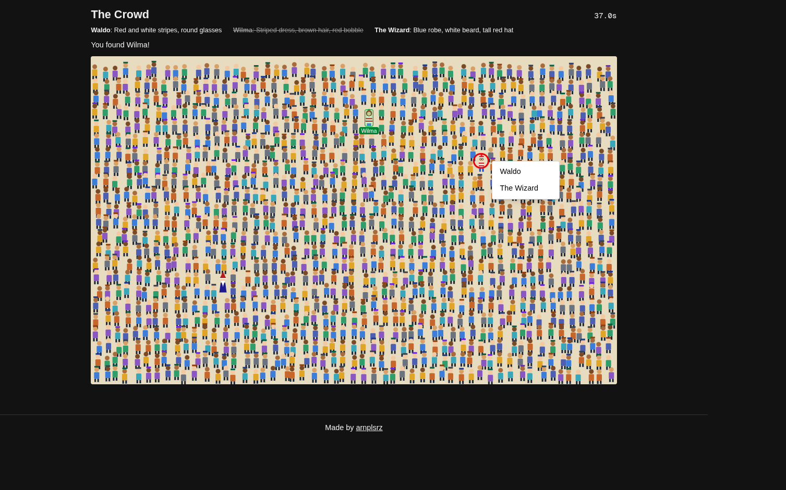
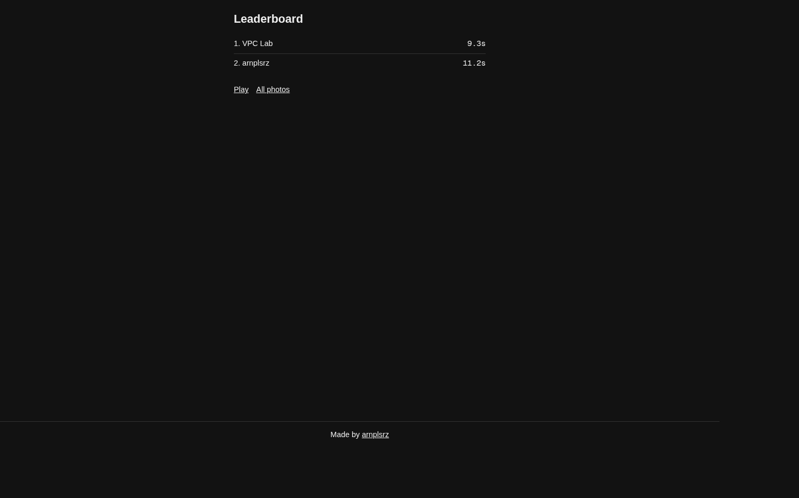
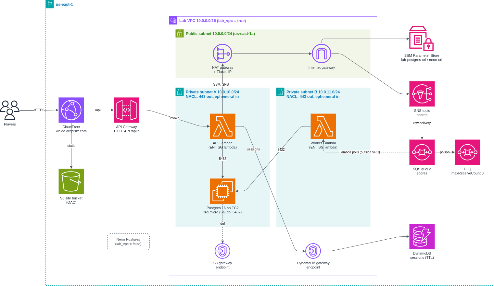

# Where's Waldo

A photo tagging game built for [The Odin Project](https://www.theodinproject.com/lessons/nodejs-where-s-waldo-a-photo-tagging-app). Pick a photo, click a spot, choose who is there, and find every character as fast as you can. The fastest times land on a per-photo leaderboard.

## Screenshots

| Photos | Game | Leaderboard |
| --- | --- | --- |
|  |  |  |

## Features

- Targeting box with a character dropdown, click-away and Escape to dismiss
- Keyboard play: arrow keys move the target, Shift for larger steps, Enter to tag
- Coordinates are normalized fractions, so hits work at any screen size
- Character locations never reach the browser until found
- The server owns the timer, so the time can't be faked
- Top 10 leaderboard per photo

## Tech stack

| Layer | Tools |
| --- | --- |
| Frontend | Next.js (static export), React, Tailwind CSS |
| API | Express 5 on AWS Lambda behind API Gateway |
| Data | Postgres with Prisma 7, DynamoDB for game sessions |
| Scores | SNS, SQS and a worker Lambda with a dead-letter queue |
| Infra | Terraform, S3 and CloudFront, Cloudflare DNS |
| Tests | Jest and SuperTest |

## Architecture



Source: [docs/architecture.drawio](docs/architecture.drawio)

- CloudFront serves the static site from a private S3 bucket and routes `/api/*` to API Gateway.
- Each game is a DynamoDB session with a TTL. Guesses are hit tested on the server.
- A finished score is published to SNS, queued in SQS and written to Postgres by a worker. Duplicate deliveries are ignored by primary key.

## Local development

Requires Node 24, pnpm and a local Postgres.

```bash
pnpm install
createdb waldo && createdb test_waldo
cp api/.env.example api/.env
echo "NEXT_PUBLIC_API_URL=http://localhost:4000" > .env.development.local

pnpm --filter api migrate
pnpm --filter api seed
```

Run each in its own terminal:

```bash
pnpm --filter api dev:dynamo
pnpm --filter api dev
pnpm dev
```

Open [http://localhost:3000](http://localhost:3000).

## Tests

```bash
pnpm test
```

Runs unit tests for the game rules and integration tests for the API routes and score worker against `test_waldo` and an in-process DynamoDB.
